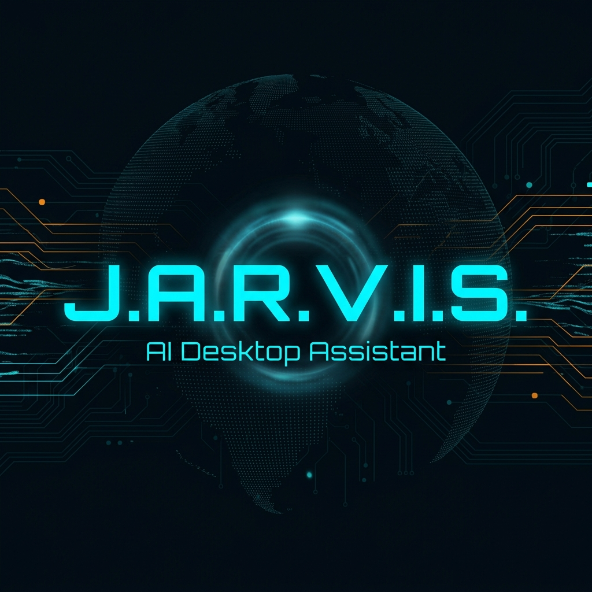
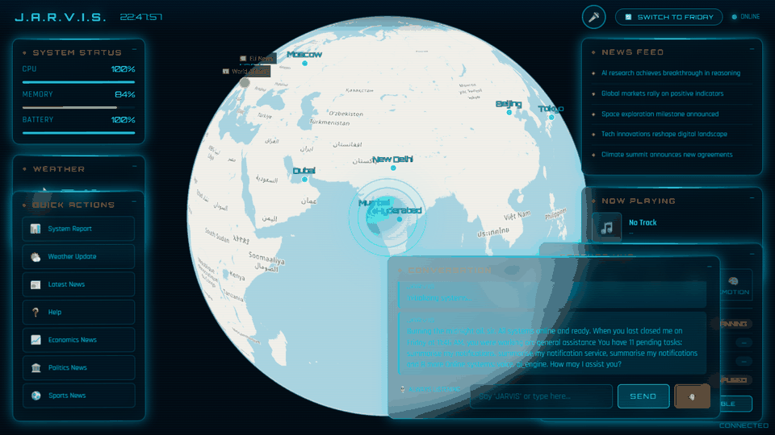
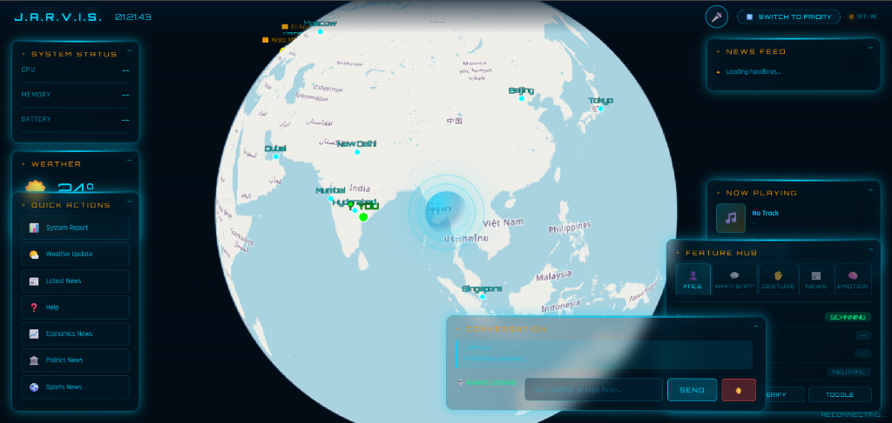
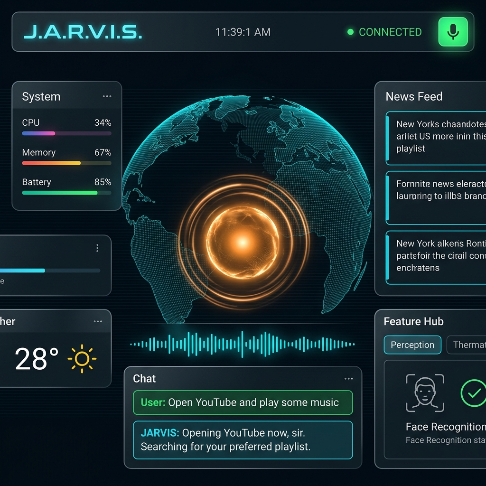

# 🤖 J.A.R.V.I.S. — AI Desktop Assistant

[](https://github.com/Raghava00001/Jarvis/actions/workflows/ci.yml)

> **Just A Rather Very Intelligent System**
> A voice-first desktop assistant for Windows: real-time two-way voice through Gemini Live, an Iron Man–style Web HUD, real system control (apps, volume, brightness, screenshots), and optional gesture, face and emotion features.

<p align="center">
  
</p>

## 🖥️ See It In Action

<p align="center">
  
  <br>
  <em>Live demo: time, a joke, "restart my PC" asks for confirmation and is cancelled, then the news.</em>
</p>

<p align="center">
  
  <br>
  <em>The Web HUD: 3D globe, system vitals, news feed, chat and Feature Hub, updated live.</em>
</p>

<p align="center">
  
  <br>
  <em>Voice mode: waveform, live tool execution and spoken replies.</em>
</p>

> 🎥 To record your own demo GIF of just the HUD, start JARVIS and run `python docs/record_hud_demo.py`. It drives a headless Edge/Chrome and never captures the rest of your screen.

---

## What it does

- **Talks and listens at the same time.** Gemini Live (`gemini-2.5-flash-native-audio`) streams audio both ways, with echo suppression and barge-in.
- **Only listens when you mean it.** The mic is always on, but JARVIS acts only after you say "Jarvis" or "Friday" (or type in the HUD), then stays awake for a 20-second follow-up window. Background chatter and videos can't trigger it.
- **Actually does things.** "Open Chrome" calls a real tool that opens Chrome. Gemini Live has 14 tools: apps, YouTube, web search, news, weather, screen control, workflows and more.
- **Answers simple commands instantly.** A keyword fast path handles common commands (open/close apps, volume, brightness, time) in milliseconds without calling an LLM.
- **Asks before risky actions.** PC shutdown and restart always need a spoken or typed "confirm".

---

## How a command flows

```
 Voice / HUD text
        │
        ▼
 websocket_server.py ── Gemini Live session active? ──► Gemini Live (voice + 14 tools)
        │ no                       (power commands and confirmations stay local)
        ▼
 Fast path            open / close app, volume, brightness, screenshot, time …
        │ no match
        ▼
 process_command      quiet mode, PC shutdown/restart (with confirmation),
        │             exit JARVIS, keyword overrides (email, reminders, apps …)
        ▼
 BrainAdapter         IntentModel (sentence-transformers kNN) → EntityExtractor
        │             → DecisionEngine → EmotionRouter
        ▼
 IntentRouter / HUD handlers / FallbackProcessor
        │
        ▼
 Gemini 2.0 Flash (text) for open-ended questions
```

### Key modules

| Module | Role |
|--------|------|
| `jarvis/gui/desktop_gui.py` | Entry point used by `start_jarvis.bat`. Starts the WebSocket server and the HUD web server, then opens the HUD. |
| `jarvis/gui/websocket_server.py` | Central gateway: WebSocket on `127.0.0.1:8765`, command routing, Gemini Live lifecycle, power-action confirmation. |
| `jarvis/gui/web_hud_launcher.py` | Serves the HUD on `127.0.0.1:8080` and injects the per-session WebSocket token. |
| `jarvis/core/gemini_live_engine.py` | Full-duplex audio, tool declarations and tool execution. |
| `jarvis/core/brain_adapter.py` | ML pipeline: intent → entities → decision → emotion. Reports clearly when it is running in keyword-only mode. |
| `jarvis/core/intent_model.py` | Embedding-based intent classifier. Raises `IntentModelUnavailable` if the model can't load. |
| `jarvis/core/safe_exec.py` | Validated `open`/`close` app helpers. Never uses a shell. |
| `jarvis/core/user_profile.py` | Loads personal settings from the gitignored `user_profile.json`. |

---

## Quick start

**Requirements:** Windows 10/11, Python 3.12, a [Gemini API key](https://aistudio.google.com/apikey), mic and speakers. A webcam is optional.

```powershell
git clone https://github.com/Raghava00001/Jarvis.git
cd Jarvis
python -m venv .venv
.venv\Scripts\activate
pip install -r requirements.txt            # pinned core dependencies
pip install -r requirements-optional.txt   # optional: face, emotion, OCR, calendar, Spotify
copy .env.example .env                     # then set GEMINI_API_KEY
copy user_profile.example.json user_profile.json   # optional: your name for face auth
```

Run it:

```powershell
start_jarvis.bat
```

Or run `python jarvis/gui/websocket_server.py`. Both start the WebSocket server and the HUD, served at **http://localhost:8080**.

### Configuration

`.env` (never committed):

```env
GEMINI_API_KEY=your_gemini_api_key_here   # required
JARVIS_USE_GEMINI_LIVE=1                  # 1 = full-duplex voice (Gemini Live)
JARVIS_WAKE_WORD=1                        # 0 = respond to all speech (no wake word)
JARVIS_AWAKE_WINDOW=20                    # seconds JARVIS stays awake after being addressed
GROQ_API_KEY=                             # optional: knowledge Q&A
OPENWEATHER_API_KEY=                      # optional: weather
NEWS_API_KEY=                             # optional: news
SMTP_EMAIL=                               # optional: Gmail
SMTP_PASSWORD=
```

`user_profile.json` (never committed) holds `owner_name` (who face recognition treats as the owner), `creator_name` and `creator_full_name`. You can also set them with the `JARVIS_OWNER_NAME`, `JARVIS_CREATOR_NAME` and `JARVIS_CREATOR_FULL_NAME` environment variables.

---

## Voice commands

Start with "Jarvis" (or "Friday"); follow-ups within 20 seconds don't need the name.

```
"Jarvis, open YouTube" / "close Chrome"  → app control
"Set volume to 50" / "Brightness up"     → system control
"Take a screenshot"                      → saved to Pictures
"What's the weather like?"               → weather
"Tell me the news"                       → headlines
"Remind me to call Mom in 30 minutes"    → reminder
"Play lo-fi on YouTube"                  → YouTube
"Switch to Friday"                       → persona swap
"Restart the computer" … "Confirm"       → restart (needs confirmation)
"Shutdown" / "Exit Jarvis"               → closes JARVIS (not the PC)
```

---

## 🔒 Security

JARVIS can run commands on your PC, so I audited it and fixed these issues in v2.1:

| Issue | Before | Fix |
|-------|--------|-----|
| **Remote command execution from any website** | The WebSocket on `localhost:8765` accepted any connection, so a web page you visited could send it commands. | The server only accepts the HUD's origin, and every client must present a random per-session token (`secrets.token_urlsafe`). The HUD server injects the token into its page, where other sites can't read it. |
| **Shell injection** | App names were pasted into shell strings (`taskkill /IM {name}.exe`, `start {app}`, with `shell=True`), so "close chrome & …" ran a second command. Gemini's tool arguments took the same path. | `safe_exec.py` checks names against a strict pattern and runs argument lists without a shell. A test fails if a formatted shell command reappears. |
| **Accidental shutdown/restart** | Substring matching meant "my phone rebooted" restarted the PC and "how do I shutdown linux?" quit JARVIS. Gemini could restart the PC without asking. | Commands are matched as whole phrases. PC shutdown/restart always needs a confirmation within 30 s, including when Gemini requests it. |
| **XSS in the HUD** | LLM replies and news headlines went into `innerHTML`. | Chat text is inserted with `textContent`, and headlines are HTML-escaped. |
| **HUD exposed on the LAN** | The HTTP server bound to all network interfaces and called `os.chdir` on the whole process. | It binds to `127.0.0.1` only and serves its directory without changing the working directory. |
| **Personal data in the repo and release** | Chat/memory databases, face encodings, a face photo, logs and personal details were committed or zipped. | Untracked and gitignored. `zip_release.py` packages only git-tracked files and also excludes `*.db`, `*.pkl`, `*.log`, face data and keys. Personal details moved to `user_profile.json`. |
| **Unsafe deserialization** | Face encodings, the Calendar token and the committed intent-embedding cache (`allow_pickle=True`) were pickles. | All use JSON or plain numeric arrays now; legacy pickles are ignored. |
| **Silent ML failure** | If the embedding model failed to load, classification quietly returned `(None, 0.0)`. | `IntentModelUnavailable` is raised. BrainAdapter logs an error and labels its keyword fallback `DEGRADED`. |

Every fix has a regression test in `tests/test_security_regressions.py`.

---

## What's new in v2.9: gestures, WhatsApp drafts, mood, and fixes from real use

| Area | Before | After |
|---|---|---|
| Hand gestures | Never ran (the server imported a class that doesn't exist) | Palm stops speech, thumbs up/down answers a question, peace sign wakes JARVIS, swipes and fist control YouTube, music, browser tabs, PDFs and slides. Off until you say "enable gestures"; the camera is only on while they are |
| WhatsApp | Pressed Enter on the first search result: could message the wrong person | Types a draft you can see; sends only when you say "send". A thumbs-up never sends |
| Mood | Detected, then ignored | Replies adapt their tone to how you seem to feel |
| Your data | Alarms, tasks and habits were tracked in git and changed with every use | Ignored by git; never in commits or releases |
| Code | `process_command` was 475 lines; bare `except:` blocks hid errors | Split into named steps; no bare `except:` |
| Volume / brightness by voice (v2.9.1) | "Brightness decreased" while nothing changed, in a second voice | One `SystemControl.adjust()`: changes the level, reads it back, reports the truth |
| Follow-ups (v2.9.1) | Muted after "Hey Jarvis"; the 20 s window ran out while a long answer was still playing | A conversation stays open until 5 minutes of silence; "go to sleep" ends it |
| Speech (v2.9.1) | Sentences cut off; English transcribed and answered in Telugu | Waits for 900 ms of silence; replies in English unless you clearly speak another language |
| Stories by voice (v2.9.1) | Written, never told ("Sweet dreams, sir") | Narrated in full, about the topic you asked for |

---

## What's new in v2.8: one voice, a stable connection, better understanding

| Problem | Before | After |
|---|---|---|
| JARVIS spoke twice | The server's voice and the browser's voice both spoke each reply; a handler that only spoke made the AI answer again | Each command is a turn: what handlers say becomes the reply, spoken once (server voice; the browser only as a fallback; Gemini in live mode) |
| WebSocket overload | Every dropped connection left a stats/weather/news task running forever; network calls ran on the event loop | Tasks are cancelled however a connection ends; blocking work runs in worker threads; all sends go through per-client queues |
| "stop" during a slow answer | Queued behind the command | Answered at once; also silences a line still being synthesised and interrupts Gemini Live |
| Gemini Live dropped its connection | Went silent for good | Reconnects |
| Alarms and reminders in live mode | Silently dropped | Announced by whichever output owns the audio |
| "explain the history of Rome", "they said", "sometimes" | Substring matching: a story, a greeting, the time | Whole-word matching; precise rules beat the ML guess |
| "news about diabetes" | General headlines | Spoken briefing: dated background figures, this month's headlines with sources |
| "what is this?", "read the screen" | The AI didn't know what "this" was; OCR needed Tesseract | A screenshot goes to Gemini vision |
| "switch to the next tab" | Tried to open an app called "the next tab"; keys went to the HUD | Tab commands, with focus handed back to your app first |
| Stories | Cut at 400 characters, topic ignored, four copies of the code | Full length, about what you asked, one implementation |
| Timers | Never set (`set_timer` didn't exist), yet "Timer set" | Real timers; alarms report failures |
| "switch to <app>" | The spoken name was pasted into PowerShell (injection) | Win32 calls through AppSwitcher |
| Rejected Groq/OpenRouter keys | Retried on every question (slow answers) | Skipped after the first 401 |

---

## What's new in v2.7: no more made-up answers

| Command | Before | After |
|---|---|---|
| "take a note buy eggs" | Went to the AI chat; nothing was saved | Saved with SmartNotes; "show my notes" reads them back |
| "read my clipboard" | The AI made up an answer | Reads the real clipboard |
| "read the screen" | The AI made up an answer (OCR wasn't installed) | Says that screen reading needs Tesseract; a duplicate OCR branch in the server was removed |
| "translate hello to spanish" | Treated as a greeting | Translated by the AI |
| "send email to bob saying hi" | Checked the inbox | Asks for an email address |
| Any typed question (Live mode off) | Google retired `gemini-2.0-flash` (hard-coded in 3 places): 404, then an unrelated greeting | `core/llm.py`: `gemini-flash-latest` with a fallback chain and honest "couldn't reach the AI" |
| An overloaded model | No request timeout: one hung call froze the whole server | 15 s timeout per model; the router runs off the event loop |
| Knowledge answers | Only Groq/OpenRouter; a rejected key meant no answers | Gemini as the last fallback |

`JARVIS_Project_Documentation.md` now has verified feature statuses instead of an all-✅ table.

---

## What's new in v2.6: architecture

The layered design (perception → understanding → decision → action → output) now
holds in the running code too. See [docs/ARCHITECTURE.md](docs/ARCHITECTURE.md).

| Problem | Effect | Fix |
|---|---|---|
| 37 modules loaded twice (`core.X` and `jarvis.core.X`) | Two state managers in one JARVIS | One module identity; leftover `core.X` imports map to the same module |
| Server and core each built ~25 subsystems | 2 alarm systems, 2 reminder checkers (reminders could fire twice), 2 hotkey registrations | `jarvis/core/services.py` registry: every subsystem exists once |
| Local imports made names local to whole functions | "bluetooth on" crashed | Removed 37 shadowing imports; test forbids them |
| Undefined names (pyflakes) | web search and "switch to <app>" crashed | Fixed; pyflakes test |
| Classifier had no examples for 26 handlers; keyword fallback matched substrings | "weather in new york" → web search, "set a timer" → the time, "translate hello" → greeting | Examples per handler; whole-word rules |
| Harmless commands asked "56% sure… proceed?" with no way to answer | "hello" and "help" got a question | Low-risk intents proceed; keyword layer corroborates; "yes" answers |
| Weather cache ignored the city; "new york" parsed as "new" | London got Hyderabad's weather | Per-city cache, multi-word cities |
| Screen control imported a class that doesn't exist | "scroll down", "next tab" never worked by voice | Fixed; added tab and zoom commands |
| `python jarvis/gui/websocket_server.py` | Failed to start (found in live testing) | Fixed; test loads every entry point as a script |
| A thread per spoken reply | Several threads played audio through pygame at once: native crash (0xC0000005) in 3 of 6 long sessions | One speech queue + audio lock: 0 crashes in 6 sessions; replies no longer overlap |

Unwired features (world monitor, AI search, unified perception, multimodal emotion)
moved to `jarvis/experimental/` with a README on how to wire them in.

---

## What's new in v2.5: 3× faster startup

The HUD used to take **15.5 s** to come online, mostly spent importing torch, TensorFlow, Whisper and sentence-transformers just to check they were installed. Those checks now use `importlib.util.find_spec`, and the libraries load when first used (the existing Phase 2 background thread still warms the models).

| Milestone | Before | After |
|---|---|---|
| HUD online | 15.5 s | **4.8 s** |
| ML models ready (background) | 19.6 s | 18.9 s |

A test starts the server in a fresh process and fails if any heavy ML library is imported at startup.

---

## What's new in v2.4: real data, honestly shown

| Issue | Before | After |
|-------|--------|-------|
| **News** | The RSS parser needed `lxml`, which was never installed. Every fetch failed silently, so the HUD showed **invented headlines** as if they were news. | A small standard-library RSS parser (`jarvis/core/rss.py`): real Google News headlines, no new dependency. |
| **Fallbacks** | When weather or news failed, the HUD showed made-up data ("24°, Partly Cloudy"). | It says "Weather unavailable" / "Headlines unavailable" instead. |
| **Spoken weather** | Read fields the weather service never returns: "Current conditions in your area: N/A°C, unknown". | "Current conditions in Hyderabad: 23°C, Clear. Humidity at 69%, wind 8 km/h." |
| **"Lock my screen"** | No handler, so it went to general chat. | Locks Windows (Win+L) via the Windows API, no shell. |
| **News search** | Search words went into the URL unencoded (`&` broke queries). | Properly encoded. |

---

## What's new in v2.3: wake word

During live testing JARVIS acted on background speech (paused a video, reopened Paint) because Gemini Live hears everything and nothing filtered it. Now:

- Speech that doesn't say **"Jarvis"/"Friday"** can't run tools, its reply is muted, and it stays out of the chat.
- Saying the name (or typing in the HUD) opens a **20-second follow-up window**.
- It matches the name even when Gemini splits it across transcript fragments ("Ja" + "rvis"), and in Telugu, Hindi, Tamil and Kannada spellings.
- Verified against the real Gemini Live API: "Open notepad please" → tool blocked, reply muted; "Jarvis, open notepad please" → Notepad opens and JARVIS answers.

---

## What's new in v2.2

| Area | Before | After |
|------|--------|-------|
| **Routing** | BrainAdapter's intent names (`get_time`, `volume_up` …) didn't match the handler names (`time`, `volume` …), so only **11 of 29** everyday commands reached a handler. | A translation table plus a keyword safety net: **27 of 29** (the other two are handled earlier by the fast path). |
| **Voice** | Microsoft's endpoint rejects `edge-tts 7.2.8` (HTTP 403) and the HUD had no fallback, so JARVIS went silent. | `edge-tts 7.3.1`, an offline pyttsx3 fallback, and a circuit breaker after 3 failures. |
| **Embedding cache** | Loaded with pickle; only checked the number of intents, so edited examples kept stale vectors. | Plain arrays plus a SHA-256 fingerprint of the model and examples; reloads instantly and rebuilds when examples change. |
| **Boot briefing** | "You have 11 pending tasks: Unknown, Unknown, Unknown". | Lists the real tasks ("… and 8 more"). |
| **Startup** | A context-memory initialisation that always failed and logged an error. | Removed; it's loaded lazily on first use. |

---

## Testing

```powershell
pip install -r requirements-dev.txt
python -m pytest tests/ -q
```

**593 tests pass:**
- smoke tests: boot, Gemini Live dedup and echo gate, BrainAdapter, persona switching
- NLP and router unit tests
- 67 security and regression tests
- 19 tests for the v2.2 upgrades (routing, embedding cache, TTS fallback, boot briefing)
- 25 wake-word tests, including the real receive loop with a fake Live session
- 15 tests for real news, honest fallbacks, spoken weather and lock screen
- 4 fast-boot tests (no heavy ML imported at startup)
- architecture invariants: one instance per subsystem, no module loaded twice, no shadowing imports, no undefined names, entry points start
- routing corpus: real commands through the real pipeline, side effects stubbed
- v2.8: one voice per reply, WebSocket backpressure and task cleanup, whole-word understanding, topic news, screen vision, tabs, timers, stories; every `self.method()` call must exist
- v2.9: gesture recogniser and server wiring, WhatsApp drafts, mood, the real Gemini Live voice-tool code with only the speaker, screen and keyboard faked

CI runs the same suite on `windows-latest`.

---

## Project structure

```
jarvis/
├── core/        # ~70 modules: Gemini Live engine, BrainAdapter, intent model, handlers,
│                #   system control, reminders, notes, news, weather, face, gestures …
├── gui/         # websocket_server (gateway), desktop_gui (entry), web_hud_launcher,
│   │            #   state_controller, mood_engine, command_processor, fallback_processor
│   └── web_hud/index.html   # the HUD (single-file app)
├── data/        # intent embedding cache, small runtime JSON (databases are gitignored)
└── utils/
tests/           # smoke, NLP, router and security regression tests
docs/            # architecture notes, screenshots, demo recorder
```

---

## Known limitations / future work

- **`websocket_server.py` is still large** (~3,070 lines, down from 3,240). Command rules and the fast path now have their own modules, but some features are still implemented in more than one path (`process_command` keyword overrides, `fallback_processor`, Gemini tools). Next step: have those call the `HANDLER_MAP` handlers.
- **Logging is mostly `print()`.** A structured logger exists (`core/logger.py`) but isn't used everywhere yet.
- **Runtime data lives in two folders,** `jarvis/data/` and `jarvis_data/`, and the two `tasks.json` files use different formats (`task` vs `description`).
- **Windows only:** system control uses Windows APIs.
- **Gemini API key required:** no offline LLM fallback.
- **Single user:** designed as a personal assistant.

---

## Tech stack

| Layer | Technology |
|-------|-----------|
| Voice AI | Gemini Live (`gemini-2.5-flash-native-audio`), Edge TTS |
| Text AI | Gemini 2.0 Flash, Groq (Llama 3.3 70B) for knowledge Q&A |
| NLP | sentence-transformers (`all-MiniLM-L6-v2`), custom intent/entity pipeline |
| Vision | MediaPipe, OpenCV, optional facenet/deepface |
| UI | Vanilla HTML/CSS/JS HUD over WebSocket, customtkinter/pygame desktop |
| System | pyautogui, pycaw, psutil, pywin32 |
| Storage | SQLite, JSON |

---

## License

MIT. See [LICENSE](LICENSE).

## Acknowledgments

- **Google Gemini:** the Live API and Flash models
- **MediaPipe:** hand and face tracking
- **The Iron Man films:** the inspiration for JARVIS
