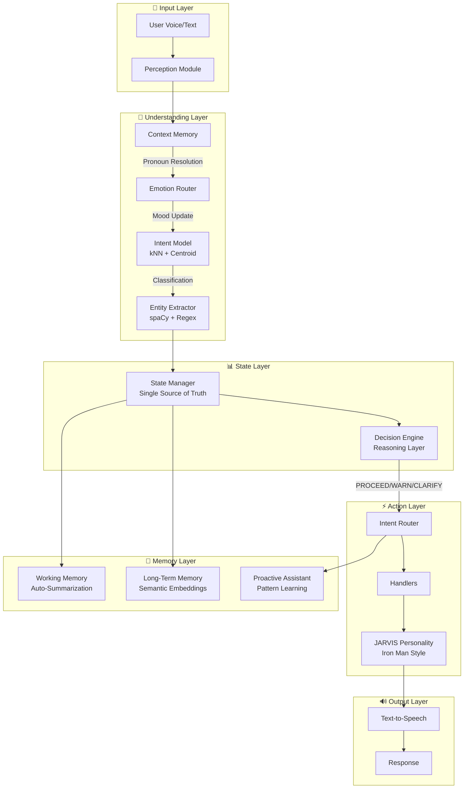
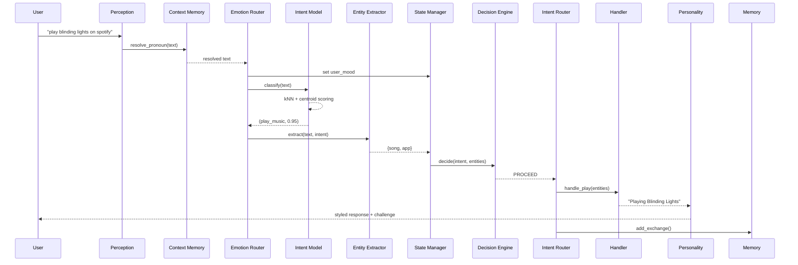
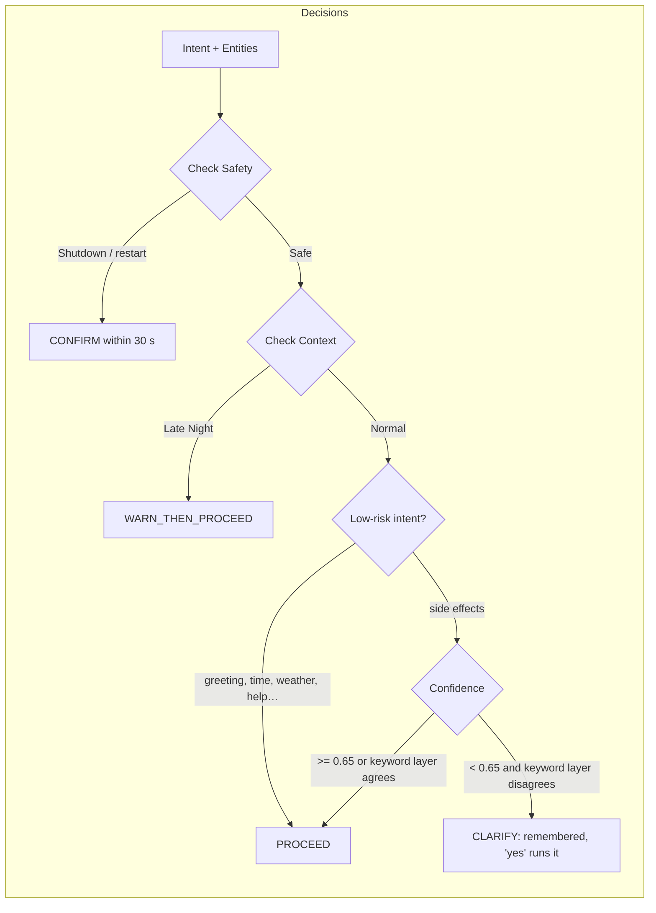

# JARVIS Architecture

## High-Level System Diagram



## Pipeline Flow



## Module Responsibilities

| Module | Responsibility |
|--------|----------------|
| **Perception** | Voice recognition, TTS output |
| **Context Memory** | Pronoun resolution, working memory, summarization |
| **Emotion Router** | Detect user mood, update state |
| **Intent Model** | Classify intent (kNN + centroid + rejection) |
| **Entity Extractor** | Extract entities (spaCy + regex hybrid) |
| **State Manager** | Single source of truth for all state |
| **Decision Engine** | Reason about HOW to handle (warn/clarify/refuse) |
| **Intent Router** | Dispatch to correct handler |
| **Personality** | Iron Man style, challenges, wit |
| **Handlers** | Music, Alarm, Apps, Search, etc. |
| **Proactive Assistant** | Pattern learning, suggestions |

## Decision Engine Flow



## How the design is implemented (v2.6 – v2.10)

### One request, end to end

```
HUD text / voice
   │
   ├─ Gemini Live on? ── wake word gate ── Gemini voice tools (_tools table) ──┐
   │                                                                          │
   ▼                                                                          │
messages.py        typo correction (core/typo_fix.py), mood, dedupe of speech │
fast_path.py       instant rules: open/close app, volume, pause, time         │
commands.py        one command = one turn: pending answers, PC power (always  │
                   confirmed), server-level steps (tasks, wellness, habits …) │
   ▼                                                                          │
router.py          BrainAdapter (embeddings + entities + decision) and the    │
                   keyword classifier (rule sections); precise rules win      │
   ▼                                                                          │
HANDLER_MAP        intent_handlers.py: ONE implementation per feature  ◄──────┘
   ▼                    (router, HUD fallback and voice tools all call it,
   │                     with one context: server._handler_context())
fallback_processor HUD-only commands, then the keyword classifier's handler
   ▼
AI                 Groq → OpenRouter → Gemini (core/knowledge.py, core/llm.py)
   ▼
Output             one voice per reply (speech.py): server voice, or Gemini
```

**One implementation per feature.** A feature lives in its `HANDLER_MAP` handler.
The router, the HUD fallback and Gemini's voice tools call that handler, and all
of them build the handler's context the same way (`_handler_context`). Before
v2.10 the fallback held a second copy of ~30 features; an audit of 100 commands
showed the router answering 71 and the copies 1, and the copies were where
several bugs hid (one copy fixed, the other not). They were removed.

**Voice tools are a table.** `GeminiLiveEngine._tools()` maps each tool name in
`TOOL_DECLARATIONS` to a method `(args, context, result) -> result`. A test
checks that every declared tool has a method and every method is declared.

**The keyword classifier is ordered rule sections** (`_rule_news`,
`_rule_set_alarm`, `_rule_calculation_or_screen` …), each returning
`(intent, entities)` or `_NEXT`.

### Service registry: one instance of every subsystem

`jarvis/core/services.py` is the composition root. Long-lived subsystems (perception,
alarms, reminders, hotkeys, chat history, news, weather …) are created with
`shared(Class, factory)` and exist **exactly once**, whether the WebSocket server,
`JARVISUltimate`, a handler or a Gemini tool asks for them.

Before v2.6 the server and `JARVISUltimate` each built their own copy of ~25
subsystems, and 37 modules were loaded twice (as `core.X` and `jarvis.core.X`). One
running JARVIS had two state managers, two reminder checkers on the same database
and two hotkey registrations.

### The HUD server, by responsibility

`jarvis/gui/websocket_server.py` used to be one 3,262-line class. It is now ~490 lines
(start-up, client connections, lifecycle), and `JARVISWebSocketServer` is assembled
from parts in `jarvis/gui/server/`, each owning one job:

| Part | Owns |
|---|---|
| `messages.py` | every incoming HUD message (`process_message`), mood tracking |
| `router.py` | intent classification, `HANDLER_MAP` dispatch, answering what no handler covers |
| `commands.py` | local commands; one command = one turn (`process_command`) |
| `pending.py` | questions awaiting an answer (PC power, WhatsApp drafts) |
| `speech.py` | voice output: one owner per reply, announcements, stop |
| `gestures.py` | the camera gesture thread and what each gesture means |
| `voice_input.py` | the server's own microphone loop |
| `boot.py` | loading subsystems: critical now, the rest in the background |
| `services.py` | subsystems loaded on first use |
| `transport.py` | per-client send queues, channels, thread-safe dispatch |
| `features.py` | optional imports and their `*_AVAILABLE` flags |
| `tables.py` | command tables and phrase lists |

Long rule chains are written as **named steps**: `fallback_processor.process`,
Gemini Live's `_execute_tool` (one `_tool_*` method per voice tool), the router and
the keyword classifier call one small function per rule. A step that doesn't handle
the request returns `_NEXT`, and the caller moves on to the next step.

### Logging

Modules log with `_log = logging.getLogger(__name__)`; there are no `print()` calls.
`jarvis/logging_setup.py` gives the `jarvis` loggers one console handler when the
package is imported. Output looks like it always did (`[ALARMS] System Ready`).
`JARVIS_LOG_LEVEL` in `.env` controls it: `WARNING` shows only problems, `DEBUG` also
shows every error JARVIS recovered from on its own, with its location and traceback.
An error that is deliberately ignored is still logged at debug level, never `pass`.

### Rules the tests enforce

| Invariant | Test |
|---|---|
| Every subsystem exists once; server and core share them | `tests/test_architecture.py` |
| No module is loaded under two names; always import `jarvis.*` | `tests/test_architecture.py` |
| No function re-imports a module-level name (UnboundLocalError trap) | `tests/test_architecture.py` |
| No undefined names (pyflakes) | `tests/test_architecture.py` |
| No heavy ML library is imported on the startup path | `tests/test_fast_boot.py` |
| Everyday commands reach the right handler (real pipeline, side effects stubbed) | `tests/test_routing_corpus.py` |
| Security rules (WebSocket origin + token, shell injection, power confirmation) | `tests/test_security_regressions.py` |
| Every `self.method()` call exists (the server and its parts checked as one class) | `tests/test_self_calls.py` |
| No `print()`, no silent `except: pass`, no bare `except:` | `tests/test_code_quality.py` |
| No function over 120 lines; the few older ones may only get shorter | `tests/test_code_quality.py` |
| No server file over 550 lines; the server keeps its 10 parts | `tests/test_code_quality.py` |
| pyflakes warnings only go down (a budget); no control characters in source | `tests/test_code_quality.py` |
| Every declared Gemini tool has a method, and every method is declared | `tests/test_live_tools_v2_10.py` |
| The weather, calendar, email … handlers report failures honestly | `tests/test_honest_data.py`, `tests/test_live_tools_v2_10.py` |

### Adding a feature

1. Write the handler in `jarvis/core/intent_handlers.py` and register it in
   `HANDLER_MAP`. This is the only implementation: don't add a copy anywhere else.
2. Add example phrases under the **same name** in `jarvis/core/intent_definitions.py`
   (the embedding cache rebuilds itself). If the phrasing is precise, add a keyword
   rule in `intent_classifier.py` and, if it must beat the ML guess, list the intent
   in `PRECISE_RULE_INTENTS` (`jarvis/gui/server/tables.py`).
3. If it needs a long-lived object, get it with `shared(MyClass, lambda: MyClass(...))`,
   and add it to `_handler_context()` if handlers should receive it.
4. If Gemini Live should use it, declare the tool in `TOOL_DECLARATIONS` and add one
   entry to `_tools()` that calls the handler.
5. Add a line to `tests/test_routing_corpus.py`.

See [DEVELOPING.md](DEVELOPING.md) for running, testing and the rules the tests enforce.

## File Structure

```
jarvis/
├── __init__.py               # one module identity (maps legacy core.X imports)
├── logging_setup.py          # console logging for every module (JARVIS_LOG_LEVEL)
├── core/calculator.py, typo_fix.py, memory_store.py, youtube_play.py   (v2.10)
├── core/
│   ├── services.py           # service registry (composition root)
│   ├── brain_adapter.py      # understanding pipeline
│   ├── intent_model.py       # embeddings kNN + centroid, keyword fallback
│   ├── intent_definitions.py # example phrases per intent (= handler names)
│   ├── intent_classifier.py  # rule-based classifier + entities
│   ├── entity_extractor.py   # ML entities
│   ├── decision_engine.py    # proceed / warn / clarify / refuse
│   ├── intent_handlers.py    # HANDLER_MAP: one implementation per feature
│   ├── gemini_live_engine.py # full-duplex voice, wake-word gate, tools
│   ├── jarvis_ultimate.py    # core layers + subsystems (also CLI entry)
│   ├── state_manager.py      # single source of truth
│   ├── personality.py, context_memory.py, proactive_assistant.py, …
│   └── safe_exec.py, rss.py, user_profile.py
├── gui/
│   ├── websocket_server.py   # start-up, client connections, lifecycle
│   ├── server/               # the server's parts (messages, router, commands, speech, …)
│   ├── command_rules.py      # wake / exit / power rules, WebSocket access
│   ├── fast_path.py          # instant-command rules
│   ├── web_hud/index.html    # the HUD
│   └── desktop_gui.py        # launcher window
├── experimental/             # built but not wired in (see its README)
└── data/                     # intent cache, small JSON state
```
