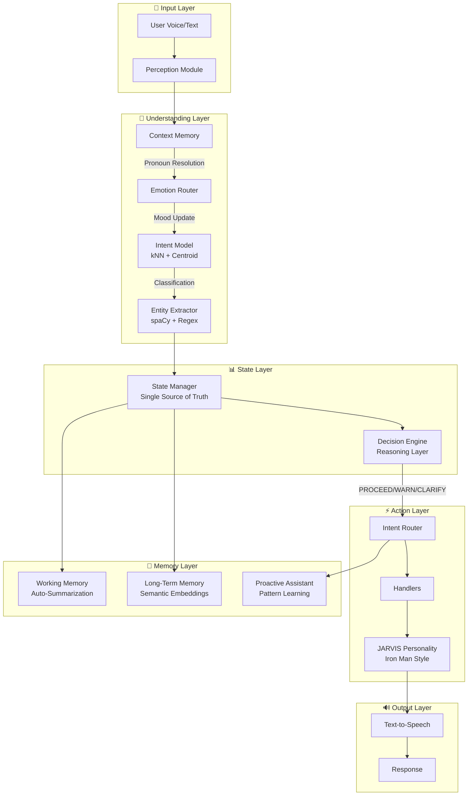
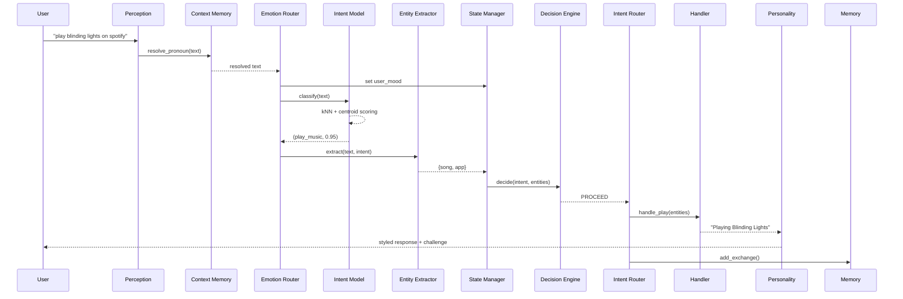
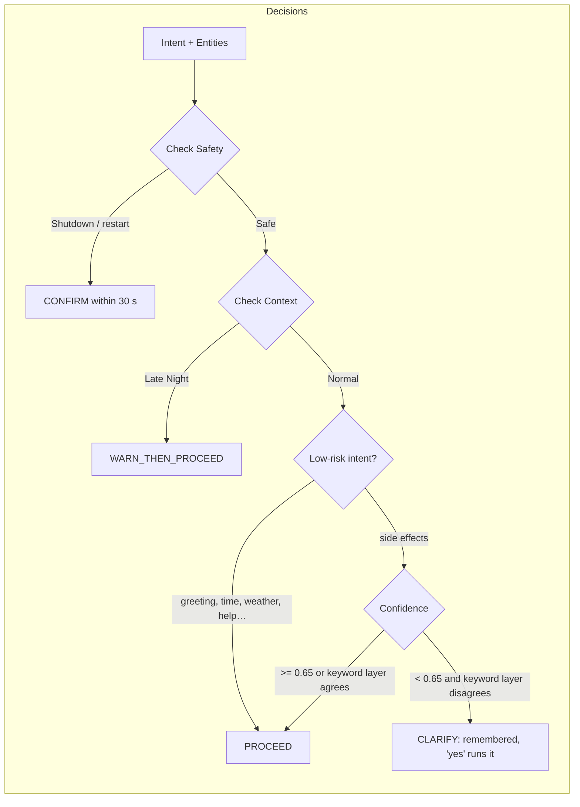

# JARVIS Architecture

## High-Level System Diagram



## Pipeline Flow



## Module Responsibilities

| Module | Responsibility |
|--------|----------------|
| **Perception** | Voice recognition, TTS output |
| **Context Memory** | Pronoun resolution, working memory, summarization |
| **Emotion Router** | Detect user mood, update state |
| **Intent Model** | Classify intent (kNN + centroid + rejection) |
| **Entity Extractor** | Extract entities (spaCy + regex hybrid) |
| **State Manager** | Single source of truth for all state |
| **Decision Engine** | Reason about HOW to handle (warn/clarify/refuse) |
| **Intent Router** | Dispatch to correct handler |
| **Personality** | Iron Man style, challenges, wit |
| **Handlers** | Music, Alarm, Apps, Search, etc. |
| **Proactive Assistant** | Pattern learning, suggestions |

## Decision Engine Flow



## How the design is implemented (v2.6)

### One request, end to end

```
HUD text / voice
   │
   ├─ Gemini Live on? ── wake word gate (gemini_live_engine) ── Gemini tools ─┐
   │                                                                          │
   ▼                                                                          │
command_rules.py   wake word, exit JARVIS, PC power → always confirmed        │
fast_path.py       instant rules: open/close app, volume, screenshot, time    │
process_command    pending confirmations, keyword overrides                   │
   ▼                                                                          │
Understanding      BrainAdapter: IntentModel (embeddings + whole-word         │
                   keyword fallback) → EntityExtractor → DecisionEngine       │
                   + keyword classifier: corroborates, fills missing entities │
   ▼                                                                          │
Action             HANDLER_MAP in intent_handlers.py  ◄───────────────────────┘
   ▼
Output             HUDPerception → HUD chat + TTS (Edge TTS, offline fallback)
```

### Service registry: one instance of every subsystem

`jarvis/core/services.py` is the composition root. Long-lived subsystems (perception,
alarms, reminders, hotkeys, chat history, news, weather …) are created with
`shared(Class, factory)` and exist **exactly once**, whether the WebSocket server,
`JARVISUltimate`, a handler or a Gemini tool asks for them.

Before v2.6 the server and `JARVISUltimate` each built their own copy of ~25
subsystems, and 37 modules were loaded twice (as `core.X` and `jarvis.core.X`). One
running JARVIS had two state managers, two reminder checkers on the same database
and two hotkey registrations.

### Rules the tests enforce

| Invariant | Test |
|---|---|
| Every subsystem exists once; server and core share them | `tests/test_architecture.py` |
| No module is loaded under two names; always import `jarvis.*` | `tests/test_architecture.py` |
| No function re-imports a module-level name (UnboundLocalError trap) | `tests/test_architecture.py` |
| No undefined names (pyflakes) | `tests/test_architecture.py` |
| No heavy ML library is imported on the startup path | `tests/test_fast_boot.py` |
| Everyday commands reach the right handler (real pipeline, side effects stubbed) | `tests/test_routing_corpus.py` |
| Security rules (WebSocket origin + token, shell injection, power confirmation) | `tests/test_security_regressions.py` |

### Adding a feature

1. Write the handler in `jarvis/core/intent_handlers.py` and register it in `HANDLER_MAP`.
2. Add example phrases under the **same name** in `jarvis/core/intent_definitions.py`.
   The embedding cache rebuilds itself when examples change.
3. If it needs a long-lived object, get it with `shared(MyClass, lambda: MyClass(...))`.
4. If Gemini Live should use it, call the handler from its tool in `gemini_live_engine.py`.
5. Add a line to `tests/test_routing_corpus.py`.

## File Structure

```
jarvis/
├── __init__.py               # one module identity (maps legacy core.X imports)
├── core/
│   ├── services.py           # service registry (composition root)
│   ├── brain_adapter.py      # understanding pipeline
│   ├── intent_model.py       # embeddings kNN + centroid, keyword fallback
│   ├── intent_definitions.py # example phrases per intent (= handler names)
│   ├── intent_classifier.py  # rule-based classifier + entities
│   ├── entity_extractor.py   # ML entities
│   ├── decision_engine.py    # proceed / warn / clarify / refuse
│   ├── intent_handlers.py    # HANDLER_MAP: one implementation per feature
│   ├── gemini_live_engine.py # full-duplex voice, wake-word gate, tools
│   ├── jarvis_ultimate.py    # core layers + subsystems (also CLI entry)
│   ├── state_manager.py      # single source of truth
│   ├── personality.py, context_memory.py, proactive_assistant.py, …
│   └── safe_exec.py, rss.py, user_profile.py
├── gui/
│   ├── websocket_server.py   # transport + orchestration
│   ├── command_rules.py      # wake / exit / power rules, WebSocket access
│   ├── fast_path.py          # instant-command rules
│   ├── web_hud/index.html    # the HUD
│   └── desktop_gui.py        # launcher window
├── experimental/             # built but not wired in (see its README)
└── data/                     # intent cache, small JSON state
```
